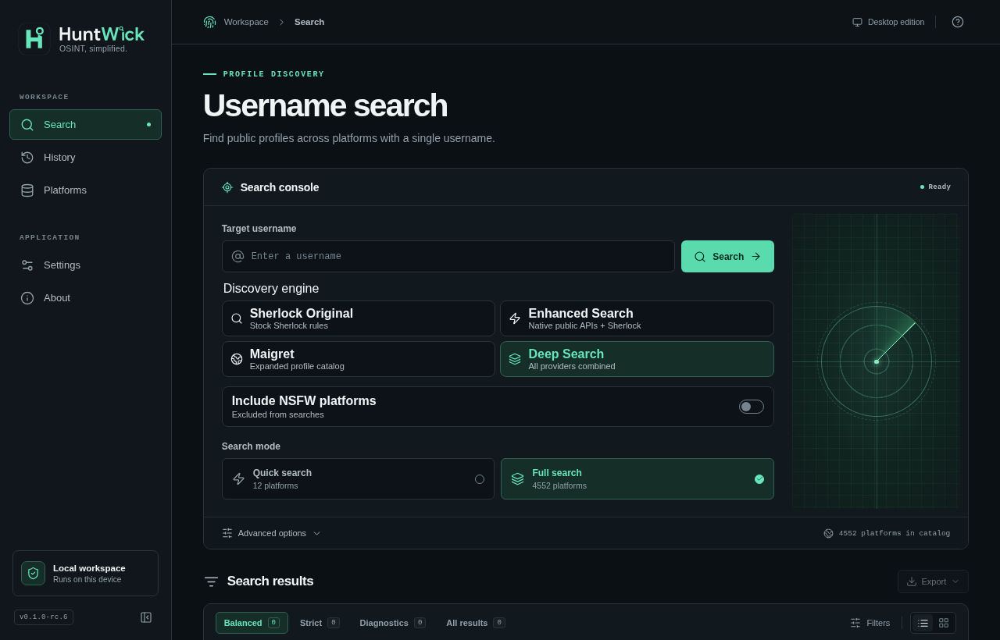
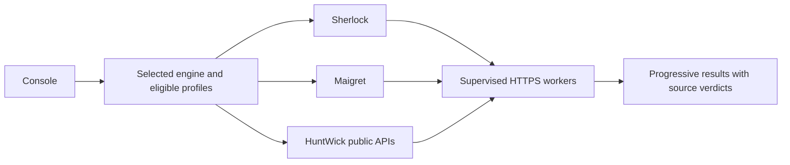
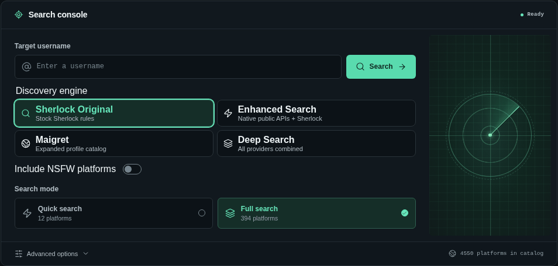
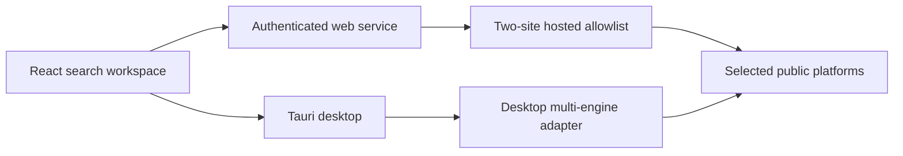

# HuntWick

**One username. Multiple engines.** Powered by Sherlock & Maigret.


[Static hero](docs/readme-assets/hero-static.png) · [RC.6 installer checkpoint](https://github.com/ish4ra/HuntWick/actions/runs/45869171776) · [Integration Web CI](https://github.com/ish4ra/HuntWick/actions/workflows/web.yml?query=branch%3Aintegration%2Frc5)

HuntWick Desktop is a local application for discovering public profiles that use a particular username. Enter a handle, keep the default **Full search** for every enabled compatible platform, or choose **Quick search** for a curated set. Select **Search** to start. Results appear as checks finish. A matching username alone cannot establish identity or common ownership.



[Desktop in light mode](docs/rc5-media/light.png) · [Web in light mode](docs/screenshots/web-light.png)

## Download the published preview

RC.5 is the published preview. In RC.4, open **Settings → Software updates → Check prereleases**, choose **Install 0.1.0-rc.5 and restart**, then **Confirm restart**. [RC.5 acceptance evidence](docs/rc5-acceptance.md) · [RC.5 checksums](https://github.com/ish4ra/HuntWick/releases/download/v0.1.0-rc.5/SHA256SUMS)

[Apple Silicon DMG](https://github.com/ish4ra/HuntWick/releases/download/v0.1.0-rc.5/HuntWick-0.1.0-rc.5-aarch64-apple-darwin.dmg) · [Intel Mac DMG](https://github.com/ish4ra/HuntWick/releases/download/v0.1.0-rc.5/HuntWick-0.1.0-rc.5-x86_64-apple-darwin.dmg) · [Windows x64](https://github.com/ish4ra/HuntWick/releases/download/v0.1.0-rc.5/HuntWick-0.1.0-rc.5-x86_64-pc-windows-msvc.exe) · [Linux Debian](https://github.com/ish4ra/HuntWick/releases/download/v0.1.0-rc.5/HuntWick-0.1.0-rc.5-x86_64-unknown-linux-gnu.deb) · [Linux AppImage](https://github.com/ish4ra/HuntWick/releases/download/v0.1.0-rc.5/HuntWick-0.1.0-rc.5-x86_64-unknown-linux-gnu.AppImage)

The installers bundle the Python runtime and Sherlock. Launch HuntWick from your applications menu. The platform directory and settings work offline. A live search needs a network connection to the selected sites.

## Search workspace in the RC.6 candidate

[Compact search console](docs/rc6-media/full-console-760.png) · [Coverage and live comparison](docs/rc6-quality.md) · [Search reliability measurements](docs/rc6-search-quality.md)

| Desktop engine | Platforms in Full search¹ | What it checks |
| --- | ---: | --- |
| Sherlock Original | 394 | Pinned Sherlock rules report the upstream verdict for each eligible site. |
| Enhanced Search | 396 | Public APIs check account identity where supported. Sherlock handles the remaining eligible sites. |
| Maigret | 4,186 | Maigret checks additional developer and community sites, including individual forum instances. |
| Deep Search | 4,552 | Native lookups, Sherlock and Maigret share a bounded time budget per profile. Expand a result to inspect overlapping verdicts. |

¹ Counts use the bundled catalog with adult and experimental sites off. Deep Search counts distinct eligible profile routes. When multiple engines cover the same profile, expand its result to see their verdicts. A larger search can return the same number of matches. During a run the console shows checks completed, speed and an estimate of the time remaining.

The pinned Maigret database contains 11,071 definitions. Upstream enables 10,335. HuntWick accepts 4,188 reviewed-route definitions before category preferences and records exclusion reasons for 6,883. Eligibility describes a supported rule. Sites can still time out, deny access or change their profiles. A provider claim and independent API evidence appear separately.





The radar uses small circular blips with larger keyboard and pointer targets. Each blip has a platform and result label; activating it opens the result link. New desktop installs enable restrained detection sounds. Scanning sounds are optional, with volume and previews in Settings. [Radar](docs/rc4-media/web-desktop.png) · [Update settings](docs/rc4-media/updates-dark.png) · [Original detection sound](docs/rc4-media/verified.wav)

The desktop Search console can include adult-labeled platforms with one persistent switch and enable experimental upstream-excluded checks separately. The diagnostic JSON export omits handles and profile URLs. [Coverage and CLI comparison](docs/catalog-audit.md)

New RC.6 installations check for stable updates. **Include prereleases** saves your choice for startup and manual checks. **Check for updates** offers the newest eligible version across the selected channels. Installation requires a newer, signed release and a configured production verification key. The manual download path remains available for Debian and development builds. [Signing and installation](docs/packaging.md)


- See the selected scope, progress, elapsed time and outcome counts. Cancel an active search to keep the results received so far.
- Balanced also includes provider claims and conflicting evidence. Strict requires stronger profile evidence. Use Diagnostics to inspect missing profiles, timeouts, access blocks, errors and inconclusive responses. Switch between table and card views, filter by category or text, and sort by platform.
- Open public profile links in the system browser, copy links, or save local CSV, JSON and HTML reports. Exported files identify the search handle and can contain personal information.
- Browse the installed platform catalog and disable individual sites. Counts reflect the actual bundled definitions, supported request types and current settings. The engine and database versions are available in Settings.
- Choose a dark, light or system theme and the density of results. Use Ctrl+K or Cmd+K to return to the username field. Enable local history to reopen past searches.

## Privacy and responsible use

Desktop history starts disabled. HuntWick Desktop runs locally without accounts, telemetry, analytics or a cloud backend. Searches contact the relevant websites, which can observe the requested username, network address and request time. Sites apply their own logging and retention policies. Preferences, opt-in history and exports live on the device. Delete saved runs in History. Files you export remain wherever you saved them.

Use public information for lawful research, with appropriate consent. Verify a possible match independently before drawing conclusions about a person. Respect platform rules, access restrictions, and rate limits. Do not use results for harassment, impersonation or discrimination.

## Development

HuntWick uses Tauri 2 and Rust for native services, React and TypeScript for the interface, and an isolated Python executable for Sherlock and Maigret. To run it from source, install the [development prerequisites](docs/development.md), then run these commands at the repository root.

```sh
npm ci
uv sync --project engine --frozen --python 3.12
uv run --project engine --frozen python engine/build.py
npm run tauri -- dev
```

Read the [architecture](docs/architecture.md), [test commands](docs/development.md), [packaging guide](docs/packaging.md) and [contribution guidelines](CONTRIBUTING.md).

## Engine and licensing

The bundled adapter invokes the pinned Sherlock and Maigret Python libraries. Desktop preserves their original verdicts. Native API evidence is labeled separately, and the hosted service retains its restricted two-site policy. The site database is pinned and integrity checked. Website behavior may change between snapshots. [Sherlock](https://github.com/sherlock-project/sherlock) · [Maigret](https://github.com/soxoj/maigret) · [snapshot provenance](engine/notices/Provenance.md) · [third-party notices](THIRD_PARTY_NOTICES.md) · [HuntWick MIT license](LICENSE)

## Roadmap

RC.6 is under candidate testing. RC.5 remains the published preview while owner testing continues.

## Web Edition

The browser radar displays actual verified and possible events. Activate a marker to open its profile. Optional synthesized detection sounds start off, and the browser loads platform logos from the same authenticated service. The web radar screenshots use synthetic demonstration events.

The access-restricted Web Edition serves the shared interface through FastAPI. Its preview catalog covers GitHub and GitLab. The service requires operator credentials and limits concurrent work. The operator can see the submitted username and client IP. Target sites receive requests from the service. Hosted deployment awaits owner approval. [Setup and privacy](docs/web-deployment.md)


[Desktop browser screenshot](docs/rc4-media/web-desktop.png) · [Mobile screenshot](docs/rc4-media/web-mobile.png) · [Web CI](https://github.com/ish4ra/HuntWick/actions/workflows/web.yml?query=branch%3Aintegration%2Frc5)


