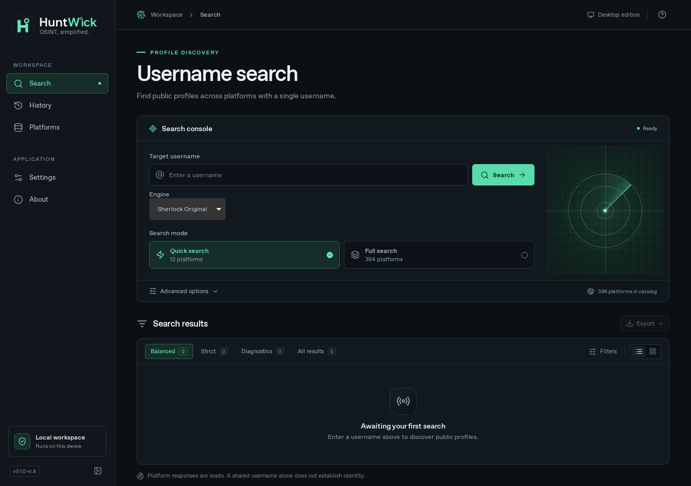
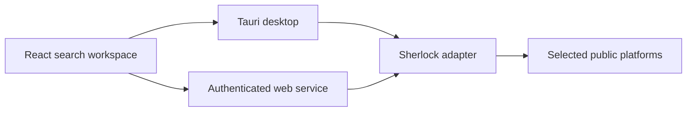

# HuntWick


[Static hero](docs/readme-assets/hero-static.png) · [Integration CI](https://github.com/ish4ra/HuntWick/actions/workflows/ci.yml?query=branch%3Aintegration%2Fdesktop-web) · [Web CI](https://github.com/ish4ra/HuntWick/actions/workflows/web.yml?query=branch%3Aintegration%2Fdesktop-web)


HuntWick Desktop is a local application for discovering public profiles that use a particular username. Enter a handle, choose **Quick search** for a curated set of platforms or **Full search** for every enabled compatible platform, then select **Search**. Results appear as checks finish. A matching username alone cannot establish identity or common ownership.



[Desktop in light mode](docs/screenshots/desktop-rc3-light.png) · [Web in light mode](docs/screenshots/web-light.png)

## Using the release candidate

**v0.1.0-rc.4** is the desktop candidate for the permanent-key upgrade from RC.3. GitHub Actions builds Windows x64 NSIS, Apple Silicon and Intel DMGs, and Linux x64 Debian and AppImage packages. Sign in to download Actions artifacts and verify their digests before installing. [Five RC.4 installers, checksums and owner checks](docs/rc4-acceptance.md) · [RC.3 manual installation](docs/rc3-acceptance.md) · [Unsigned installation guidance](docs/packaging.md)

The installers bundle the Python runtime and Sherlock. Launch HuntWick from your applications menu. The platform directory and settings work offline. A live search needs a network connection to the selected sites.

## Search workspace

**Sherlock Original** uses the pinned upstream request methods and verdicts. Provider Match means Sherlock reported Claimed. Conflicting Evidence keeps a claim visible when a denial, redirect or other response contradicts it. **Enhanced Search** uses seven reviewed public lookups and Sherlock on the remaining eligible platforms. A matching identifier in an official API can give an independently verified result. The default catalog has 394 distinct Sherlock profiles and 396 with Enhanced Search. Counts change with desktop catalog settings. [Source and coverage review](docs/provider-research.md)

The radar uses small circular blips with larger keyboard and pointer targets. Focus a blip for its platform and result state. Scanning and detection sounds are separately opt-in, with volume and previews in Settings. [Radar](docs/rc4-media/web-desktop.png) · [Update settings](docs/rc4-media/updates-dark.png) · [Original detection sound](docs/rc4-media/verified.wav)

Desktop Settings can include adult-labeled platforms after confirmation and enable experimental upstream-excluded checks separately. The diagnostic JSON export omits handles and profile URLs. [Coverage and CLI comparison](docs/catalog-audit.md)

Settings and About provide stable and prerelease update checks. Installation requires a newer, signed release and a configured production verification key. The manual download path remains available for Debian and development builds. [Signing and installation](docs/packaging.md)


- See the selected scope, progress, elapsed time and outcome counts. Cancel an active search to keep the results received so far.
- Balanced also includes provider claims and conflicting evidence. Strict requires stronger profile evidence. Use Diagnostics to inspect missing profiles, timeouts, access blocks, errors and inconclusive responses. Switch between table and card views, filter by category or text, and sort by platform.
- Open public profile links in the system browser, copy links, or save local CSV, JSON and HTML reports. Exported files identify the search handle and can contain personal information.
- Browse the installed platform catalog and disable individual sites. Counts reflect the actual bundled definitions, supported request types and current settings. The engine and database versions are available in Settings.
- Choose a dark, light or system theme and the density of results. Use Ctrl+K or Cmd+K to return to the username field. Enable local history to reopen past searches.

## Privacy and responsible use

Desktop history starts disabled. HuntWick Desktop runs locally without accounts, telemetry, analytics or a cloud backend. Searches contact the relevant websites, which can observe the requested username, network address and request time. Sites apply their own logging and retention policies. Preferences, opt-in history and exports live on the device. Delete saved runs in History. Files you export remain wherever you saved them.

Use public information for lawful research, with appropriate consent. Verify a possible match independently before drawing conclusions about a person. Respect platform rules, access restrictions, and rate limits. Do not use results for harassment, impersonation or discrimination.

## Development

HuntWick uses Tauri 2 and Rust for native services, React and TypeScript for the interface, and an isolated Python executable for Sherlock. To run it from source, install the [development prerequisites](docs/development.md), then run these commands at the repository root.

```sh
npm ci
uv sync --project engine --frozen --python 3.12
uv run --project engine --frozen python engine/build.py
npm run tauri -- dev
```

Read the [architecture](docs/architecture.md), [test commands](docs/development.md), [packaging guide](docs/packaging.md) and [contribution guidelines](CONTRIBUTING.md).

## Engine and licensing

The bundled adapter invokes the official Sherlock Python library. Desktop shows Sherlock’s original claims. Native API evidence is labeled separately, and the hosted service retains its restricted two-site policy. The site database is pinned and integrity checked. Website behavior may change between snapshots. [Sherlock](https://github.com/sherlock-project/sherlock) · [snapshot provenance](engine/notices/Provenance.md) · [third-party notices](THIRD_PARTY_NOTICES.md) · [HuntWick MIT license](LICENSE)

## Roadmap

Phase 1 focuses on a single bundled engine, reproducible native packages and local privacy controls. Candidates for later phases include better site-specific evidence and regression fixtures, production-key device acceptance, an optional second engine, history comparison, localization and PDF reports.

## Web Edition

The browser radar displays actual verified and possible events. Select a marker for details. Optional synthesized detection sounds start off, and the browser loads platform logos from the same authenticated service. The web radar screenshots use synthetic demonstration events.

The access-restricted Web Edition serves the shared interface through FastAPI. Its preview catalog covers GitHub and GitLab. The service requires operator credentials and limits concurrent work. The operator can see the submitted username and client IP. Target sites receive requests from the service. Hosted deployment awaits owner approval. [Setup and privacy](docs/web-deployment.md)


[Desktop browser screenshot](docs/rc4-media/web-desktop.png) · [Mobile screenshot](docs/rc4-media/web-mobile.png) · [Web CI](https://github.com/ish4ra/HuntWick/actions/workflows/web.yml?query=branch%3Aintegration%2Fdesktop-web)


