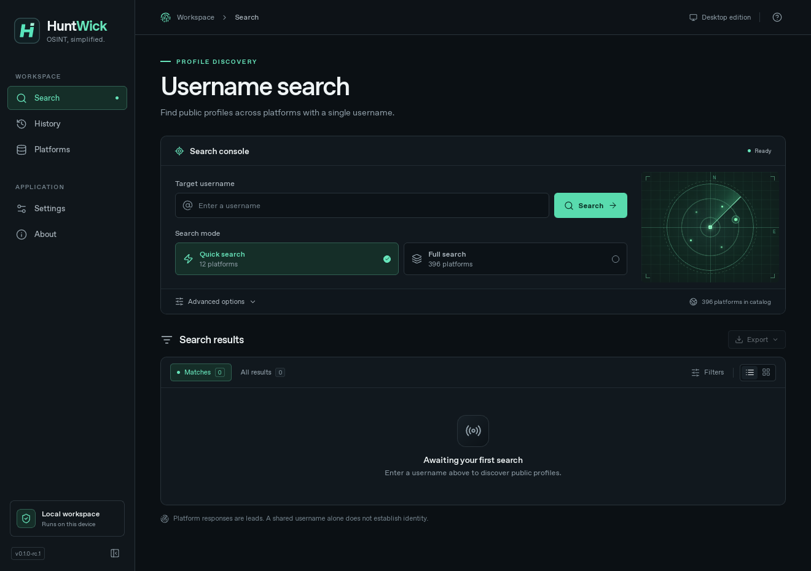
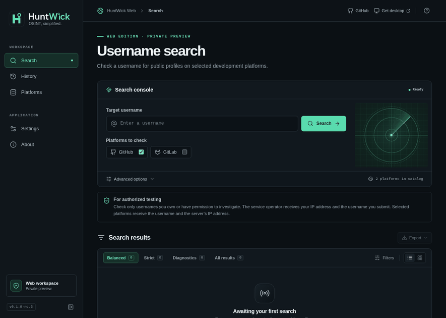
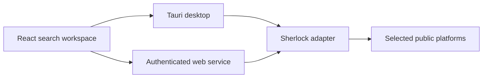

# HuntWick


[Static hero](docs/readme-assets/hero-static.png) · [Desktop CI](https://github.com/ish4ra/HuntWick/actions/workflows/ci.yml?query=branch%3Afeat%2Fphase-1-desktop-mvp) · [Private Web Edition](https://github.com/ish4ra/HuntWick/tree/feat/web-edition)


HuntWick is a local desktop application for discovering public profiles that use a particular username. Enter a handle, choose **Quick search** for a curated set of platforms or **Full search** for every enabled compatible platform, then select **Search**. Results appear as checks finish. A matching username alone cannot establish identity or common ownership.



## Using the release candidate

The development version is **v0.1.0-rc.1**. For a test installer, open a successful CI run for the implementation branch, download its artifact for your system, extract it, and compare the SHA256 checksum before installing. The packaging matrix targets Windows 10/11 x64 (NSIS installer), Apple Silicon and Intel Macs (DMG), and Linux x64 (Debian package and AppImage). Availability depends on the individual build job. Platform acceptance is tracked in [development status](docs/DEVELOPMENT_STATUS.md). See the [installation and unsigned-build instructions](docs/packaging.md) and [GitHub Actions](https://github.com/ish4ra/HuntWick/actions).

The installers bundle the Python runtime and Sherlock. Launch HuntWick from your applications menu. The platform directory and settings work offline. A live search needs a network connection to the selected sites.

## Search workspace

- See the selected scope, progress, elapsed time and outcome counts. Cancel an active search to keep the results received so far.
- Balanced shows verified and possible matches. Strict requires stronger profile evidence. Use Diagnostics to inspect missing profiles, timeouts, access blocks, errors and inconclusive responses. Switch between table and card views, filter by category or text, and sort by platform.
- Open public profile links in the system browser, copy links, or save local CSV, JSON and HTML reports. Exported files identify the search handle and can contain personal information.
- Browse the installed platform catalog and disable individual sites. Counts reflect the actual bundled definitions, supported request types and current settings. The engine and database versions are available in Settings.
- Choose a dark, light or system theme and the density of results. Use Ctrl+K or Cmd+K to return to the username field. Enable local history to reopen past searches.

## Privacy and responsible use

History starts disabled. HuntWick has no accounts, telemetry, analytics or cloud backend. Searches contact the relevant websites, which can observe the requested username, network address and request time. Sites apply their own logging and retention policies. Preferences, opt-in history and exports live on the device. Delete saved runs in History. Files you export remain wherever you saved them.

Use public information for lawful research, with appropriate consent. Verify a possible match independently before drawing conclusions about a person. Respect platform rules, access restrictions, and rate limits. Do not use results for harassment, impersonation or discrimination.

## Development

HuntWick uses Tauri 2 and Rust for native services, React and TypeScript for the interface, and an isolated Python executable for Sherlock. To run it from source, install the [development prerequisites](docs/development.md), then run these commands at the repository root.

```sh
npm ci
uv sync --project engine --frozen --python 3.12
uv run --project engine --frozen python engine/build.py
npm run tauri -- dev
```

Read the [architecture](docs/architecture.md), [test commands](docs/development.md), [packaging guide](docs/packaging.md) and [contribution guidelines](CONTRIBUTING.md).

## Engine and licensing

The bundled adapter invokes the official Sherlock Python library. HuntWick applies a conservative evidence check before displaying a positive match, so a real profile can remain inconclusive. The site database is pinned and integrity checked. Website behavior may change between snapshots. [Sherlock](https://github.com/sherlock-project/sherlock) · [snapshot provenance](engine/notices/Provenance.md) · [third-party notices](THIRD_PARTY_NOTICES.md) · [HuntWick MIT license](LICENSE)

## Roadmap

Phase 1 focuses on a single bundled engine, reproducible native packages and local privacy controls. Candidates for later phases include better site-specific evidence and regression fixtures, signed builds and updates, an optional second engine, history comparison, localization and PDF reports.

## Web Edition

The browser radar displays actual verified and possible events. Select a marker for details. Optional synthesized detection sounds start off, and the browser loads platform logos from the same authenticated service. The desktop and mobile screenshots below use synthetic demonstration events.

The access-restricted web branch serves the shared interface through FastAPI. Its preview catalog covers GitHub and GitLab. The service requires operator credentials and limits concurrent work. Deployment awaits owner approval. [Setup and privacy](https://github.com/ish4ra/HuntWick/blob/feat/web-edition/docs/web-deployment.md)



[Desktop browser screenshot](docs/screenshots/web-desktop.png) · [Mobile screenshot](docs/screenshots/web-mobile.png) · [Web CI](https://github.com/ish4ra/HuntWick/actions/runs/45377424404)


