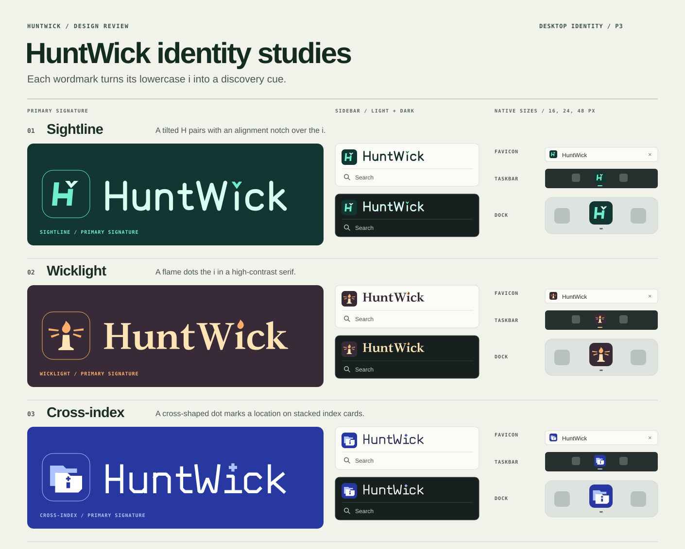

# HuntWick identity review

**Recommend Sightline.** An alignment notch forms the dot of the lowercase **i** in the wordmark. On the app icon it sits above the right stem of the **H**, giving the wordmark and monogram a recognizable detail in common. The H holds its shape at 16 px, and its mint and deep green work with HuntWick’s current interface.

| Concept | Design choice | Standalone artwork |
| --- | --- | --- |
| Sightline | Rounded lettering, an alignment notch and a tilted H. The notch is clearest at sidebar size and above. | [Icon](sightline/icon.svg) · [Wordmark for light surfaces](sightline/wordmark-on-light.svg) · [Wordmark for dark surfaces](sightline/wordmark-on-dark.svg) |
| Wicklight | A flame dots the serif i. The icon turns its stem into a lamp with rays on either side. It gives HuntWick a warmer, editorial identity. | [Icon](wicklight/icon.svg) · [Wordmark for light surfaces](wicklight/wordmark-on-light.svg) · [Wordmark for dark surfaces](wicklight/wordmark-on-dark.svg) |
| Cross-index | A cross marks a position over the angular i and on a pair of index cards. The stacked silhouette remains visible in a small tab. | [Icon](cross-index/icon.svg) · [Wordmark for light surfaces](cross-index/wordmark-on-light.svg) · [Wordmark for dark surfaces](cross-index/wordmark-on-dark.svg) |

The board shows sidebar wordmarks at 130 px wide and icon slots at 16, 24 and 48 px. View it at 100% to compare those sizes. The desktop and browser elements are review mockups. [Scalable review board](identity-board.svg)

All wordmarks and app icons use original vector paths with transparent outer corners or backgrounds. Run `python3 docs/brand-review/generate.py` from the repository root to regenerate the SVGs and PNG. The generator uses Python’s standard library and invokes Inkscape to render the PNG. The board labels use DejaVu Sans Mono and Liberation Sans. [Generator](generate.py)
