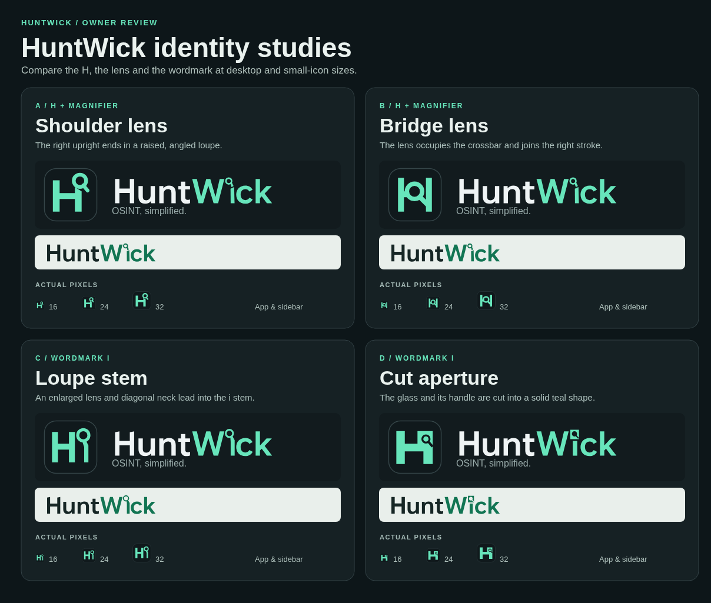

# HuntWick identity options

Four studies for owner selection. Each uses the existing two-tone HuntWick lettering and mint accent. The RC.6 candidate uses the RC.5 app and installer artwork.

| Option | Where to look |
| --- | --- |
| **A · Shoulder lens** | The right upright of the H supports a raised magnifier. Its handle angles outward, separate from the crossbar. |
| **B · Bridge lens** | The lens sits between the two uprights of the H. Its handle joins the right upright to complete the crossbar. |
| **C · Loupe stem** | The dot of the wordmark’s i becomes a lens. Its handle flows into the stem. The app icon pairs that i with the H. |
| **D · Cut aperture** | A lens and diagonal handle are cut into the solid right side of the H. The wordmark echoes the cut in a square i dot. |

Open the PNG at 100% to compare the 16, 24 and 32 pixel samples. The SVG scales for close inspection. Selection of A, B, C or D is reserved for the owner. [Full-size board](identity-options.png) · [Vector board](identity-options.svg)
